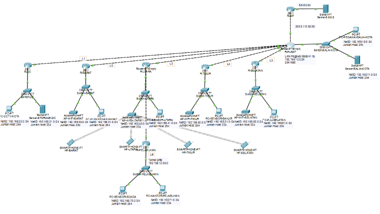
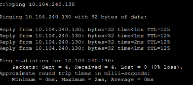
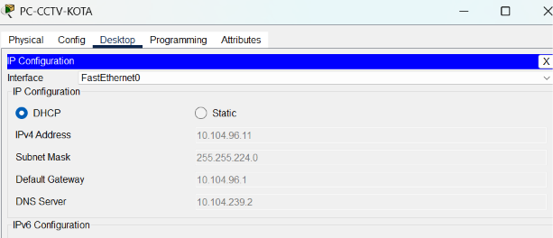
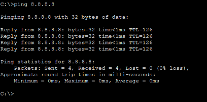

# Smart City Surabaya - ETS Jaringan Komputer (Kelompok K-13)

File proyek: `TOPOLOGI K-13.pkt` (Cisco Packet Tracer)
Network dasar: `10.104.0.0` (K = 13), sesuai perhitungan `VLSM_Subnetting.xlsx`

## 1. Topologi



Struktur topologi:

- R-ISP di puncak, terhubung ke R-PUSAT lewat 203.0.113.0/30 dan menjalankan server publik 8.8.8.8.
- R-PUSAT menjadi pusat: cabang ke R-DC (L1), R-UTARA (L2), R-SELATAN (L3), R-TIMUR (L4), R-BARAT (L5), dan LAN Balai Kota sendiri.
- R-UTARA melanjutkan ke R-PELABUHAN (L6), jadi Pelabuhan tidak terhubung langsung ke Pusat.
- Tiap router daerah melayani 2 LAN lewat satu switch: VLAN 10 untuk perangkat pengguna dan VLAN 20 untuk server. Utara, Barat, Timur, dan Selatan juga punya Access Point untuk HP.
- Link antar-router diberi label L1 sampai L6 di gambar.

Skema pengalamatan memakai VLSM dari network dasar 10.104.0.0. Tiap LAN mendapat mask sesuai kebutuhan (dari /18 sampai /25), dan link antar-router memakai /30. Rincian perhitungan ada di VLSM_Subnetting.xlsx.

| LAN | Subnet | Lokasi |
|---|---|---|
| WiFi Utara | 10.104.0.0/18 | R-UTARA |
| WiFi Selatan | 10.104.64.0/19 | R-SELATAN |
| WiFi Timur | 10.104.128.0/19 | R-TIMUR |
| WiFi Barat | 10.104.192.0/19 | R-BARAT |
| CCTV Kota | 10.104.96.0/19 | R-DC |
| Sensor Lalu Lintas | 10.104.236.0/23 | R-UTARA |
| Sensor Banjir | 10.104.232.0/22 | R-TIMUR |
| Sensor SCADA | 10.104.160.0/19 | R-PELABUHAN |
| PJU | 10.104.240.128/25 | R-SELATAN |
| Kantor Pelabuhan | 10.104.240.0/25 | R-PELABUHAN |
| Puskesmas | 10.104.238.0/24 | R-BARAT |
| Pegawai Balai Kota | 10.104.224.0/21 | R-PUSAT |
| Server Storage DC | 10.104.239.0/24 | R-DC |
| Server Balai Kota | 10.104.241.0/27 | R-PUSAT |
| Link L1-L6 | 10.104.241.32/30 sampai /30 | antar-router |
| Ke ISP | 203.0.113.52/30 | R-PUSAT ke R-ISP |

## 2. Penjelasan Topologi

Hierarki jaringan terdiri dari tiga lapis:

1. R-ISP sebagai gerbang ke internet. Router ini tidak mengetahui jaringan privat.
2. R-PUSAT sebagai pusat yang menghubungkan semua router daerah (L1-L5) dan R-UTARA yang melanjutkan ke R-PELABUHAN (L6).
3. Router daerah (R-DC, R-SELATAN, R-TIMUR, R-BARAT, R-UTARA, R-PELABUHAN) yang masing-masing melayani 2 LAN.

Setiap switch memakai dua VLAN, yaitu VLAN 10 untuk perangkat pengguna dan VLAN 20 untuk server. Satu kabel trunk menghubungkan switch ke router, lalu router membaginya menjadi subinterface (contoh G0/1.10 dan G0/1.20) dengan encapsulation dot1Q. Dengan cara ini satu port router cukup untuk dua subnet.

Aturan jalur yang dipakai sesuai ketentuan soal:

- Default route hanya ke router tepat di atasnya: R-DC, R-BARAT, R-TIMUR, dan R-SELATAN menuju R-PUSAT; R-PELABUHAN menuju R-UTARA; R-UTARA menuju R-PUSAT; R-PUSAT menuju R-ISP.
- Hanya R-PUSAT yang memegang static route ke semua LAN.
- R-PELABUHAN tidak terhubung langsung ke R-PUSAT, semua trafficnya lewat R-UTARA.

## 3. Konfigurasi

### 3.1 Soal 3 - Static Routing (VLSM)

Semua IP dipasang manual pada interface, dan interface aktif diberi perintah no shutdown.

Static route disusun berjenjang:

| Router | Route | Keterangan |
|---|---|---|
| R-DC, R-BARAT, R-TIMUR, R-SELATAN | `ip route 0.0.0.0 0.0.0.0 <PUSAT>` | Hanya default route |
| R-PELABUHAN | `ip route 0.0.0.0 0.0.0.0 10.104.241.53` | Default ke R-UTARA |
| R-UTARA | default ke PUSAT + 2 route ke LAN Pelabuhan via .54 | Mengetahui 2 LAN Pelabuhan |
| R-PUSAT | default ke ISP + 12 static route ke semua LAN | Peta lengkap |
| R-ISP | tidak ada route privat | Disengaja, prasyarat NAT |

Contoh static route di R-PUSAT:

```
ip route 10.104.96.0 255.255.224.0 10.104.241.34
ip route 10.104.0.0 255.255.192.0 10.104.241.38
ip route 10.104.160.0 255.255.224.0 10.104.241.38
ip route 0.0.0.0 0.0.0.0 203.0.113.53
```

### 3.2 Soal 4 - DHCP

Interface router dan server memakai IP statis. Perangkat pengguna (8 PC dan 4 HP) memakai DHCP. Khusus subnet CCTV, alamat diberikan oleh server, bukan oleh router.

Contoh pool DHCP di R-PUSAT:

```
ip dhcp excluded-address 10.104.224.1 10.104.224.10
ip dhcp pool LAN-BALAI-KOTA
 network 10.104.224.0 255.255.248.0
 default-router 10.104.224.1
 dns-server 10.104.239.2
```

Keterangan:

- Excluded-address melindungi gateway dan sembilan alamat pertama agar tidak disewakan, sehingga host pertama mendapat alamat .11.
- DNS mengarah ke Server Storage DC (10.104.239.2).
- Total ada 11 pool di 6 router.

Untuk CCTV, R-DC tidak memiliki pool. Subinterface CCTV diberi relay berikut:

```
interface GigabitEthernet0/1.10
 ip helper-address 10.104.239.2
```

Server-STORAGE-DC menjalankan pool bernama CCTV-KOTA (network 10.104.96.0/19, gateway .1, start IP .11). Request DHCP dari PC-CCTV diteruskan lintas subnet oleh helper-address sampai ke server.

### 3.3 Soal 5 - NAT Overload

Seluruh host mengakses server 8.8.8.8 memakai satu IP publik milik R-PUSAT (203.0.113.54):

```
access-list 1 permit 10.104.0.0 0.0.255.255
ip nat inside source list 1 interface GigabitEthernet1/0 overload
```

Keterangan:

- ip nat outside ditempatkan di G1/0 yang menghadap ISP, dan ip nat inside di 8 interface sisi dalam.
- ACL 1 mencakup seluruh 10.104.x.x sekaligus.
- Perintah overload membuat banyak host berbagi satu IP publik yang dibedakan lewat nomor port (PAT).
- R-ISP tetap tidak diberi route privat. Paket balik ditujukan ke 203.0.113.54 yang merupakan IP milik R-PUSAT sendiri, sehingga cukup connected route.

## 4. Pengerjaan

Alur pengerjaan:

1. Perhitungan VLSM dari 10.104.0.0 menghasilkan 14 LAN dan 6 link /30 (VLSM_Subnetting.xlsx).
2. Pembuatan topologi dan kabel: 8 router, 7 switch, 4 AP, 15 PC/Server/HP.
3. Pengalamatan interface, pembuatan VLAN 10/20, trunk, router-on-a-stick, dan no shutdown.
4. Soal 3: static route berjenjang, lalu pengujian dengan show ip route, ping, dan tracert.
5. Soal 4: 11 pool DHCP dengan excluded-address, helper-address di R-DC, pool CCTV di Server-STORAGE-DC, dan peralihan host ke DHCP.
6. Soal 5: ACL dan NAT overload di R-PUSAT, penandaan ip nat inside dan outside.
7. Verifikasi menyeluruh: 112 pemeriksaan otomatis terhadap file ditambah uji manual di Packet Tracer.

## 5. Bukti Pengujian

### Soal 3 - Static Routing

| Uji | Perintah/Lokasi | Hasil |
|---|---|---|
| Ping ke Kantor Pelabuhan (lewat 3 router) | PC-CCTV `ping 10.104.240.2` | Reply 4/4, TTL 125 |
| Ping lintas kota lewat R-SELATAN | PC-CCTV `ping 10.104.240.130` | Reply 4/4, TTL 125 |
| Tabel routing lengkap | R-PUSAT `show ip route` | 12 route S dan default ke ISP |
| Isolasi ISP | R-ISP `show ip route` | tanpa route privat |
| Jalur berjenjang | R-PELABUHAN `show ip route` | default via 10.104.241.53 (R-UTARA) |
| Trunk dan VLAN | Switch `show vlan brief`, `show int trunk` | VLAN 10/20 dan trunk aktif |
| WiFi lewat AP | HP-BARAT `ping 10.104.238.2` | Reply |

#### Bukti ping:

Ping PC-CCTV ke PC-Kantor Pelabuhan (10.104.240.2):


Ping PC-CCTV ke PC-PJU Selatan (10.104.240.130):



### Soal 4 - DHCP

| Uji | Perintah/Lokasi | Hasil |
|---|---|---|
| Host dapat IP dinamis dari pool router | PC-PEGAWAI, IP Configuration | 10.104.224.11/21, gateway .1 |
| Pool bekerja di router | R-PUSAT `show ip dhcp binding` | 10.104.224.11, Automatic |
| CCTV dapat IP dari server | PC-CCTV, IP Configuration | 10.104.96.11/19, gateway .1 |
| Server DHCP aktif | Server-STORAGE-DC, Services, DHCP | pool CCTV-KOTA |
| Excluded-address bekerja | host pertama tiap pool | selalu .11, tidak pernah .1 sampai .10 |

Bukti:

PC-PEGAWAI mendapat IP dari pool router (10.104.224.11):


PC-CCTV mendapat IP dari server lewat helper-address (10.104.96.11):



Hasil show ip dhcp binding di R-PUSAT:


Pool CCTV-KOTA di Server-STORAGE-DC:


Config DHCP pool di R-PUSAT:


### Soal 5 - NAT

| Uji | Perintah/Lokasi | Hasil |
|---|---|---|
| Akses ke server publik | PC-PEGAWAI `ping 8.8.8.8` | Reply 4/4, TTL 126 |
| Terjemahan PAT aktif | R-PUSAT `show ip nat translations` | 10.104.224.11 menjadi 203.0.113.54 |
| Ketentuan ISP | R-ISP `show ip route` | tetap tanpa route privat |

Bukti:

Ping 8.8.8.8 dari PC-PEGAWAI berhasil:



Hasil show ip nat translations di R-PUSAT:


Sebelum NAT dikonfigurasi, ping 8.8.8.8 dari host yang sama gagal karena R-ISP tidak mengetahui jaringan privat. Setelah NAT, ping berhasil karena R-ISP hanya melihat IP publik 203.0.113.54 milik R-PUSAT.

### Verifikasi otomatis

Selain uji manual di Packet Tracer, konfigurasi diperiksa dengan skrip otomatis terhadap isi file:

| Kelompok cek | Jumlah | Hasil |
|---|---|---|
| Konsistensi subnet kedua ujung link antar-router | 7 | PASS |
| Trunk uplink dan access VLAN sesuai subnet host | 14 | PASS |
| Gateway host sama dengan IP router di subnetnya | 14 | PASS |
| Static route tiap router sesuai aturan berjenjang | 7 | PASS |
| VLAN database, dot1Q, running=startup, device ON, duplikasi IP, SSID | 37 | PASS |
| DHCP (pool, excluded, helper, host dinamis, server statis) | 25 | PASS |
| NAT (ACL, PAT, inside 8 interface, outside 1, posisi baris) | 8 | PASS |
| Total | 112 | 112 PASS, 0 FAIL |